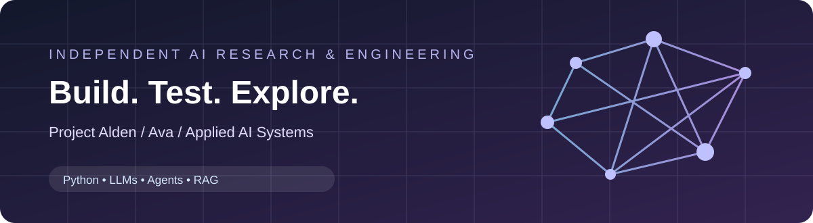

# Dr. Sophy M. Laughing
### Applied AI Engineer · Independent Researcher · Creator of Project Alden

**AI agents · Local language models · Retrieval · Evaluation · Applied engineering**

## Hello, developers.

I build practical AI software and investigate how intelligence can be represented, evaluated, and compared across humans and machines. My background includes engineering and delivering mission-critical infrastructure, and my current work concentrates on model integration, local inference, developer tools, agents, and research.

> Build it. Test it. Document what works.

## Featured work

| Project | What I'm building | Access |
| --- | --- | --- |
| **[Project Alden](https://github.com/sophlaugh/Project-Alden)** | Independent machine-intelligence research, reasoning tests and system architecture | Public documentation; private implementation |
| **Ava** | Private AI application, user interface and local model integration | Private |
| **Cobeal Systems Platform** | AI-enabled industrial engineering and circular-economy tooling | Private |
| **Digital Soph** | Conversational research agent, document grounding and integrations | Private |
| **[MiniGames](https://github.com/sophlaugh/MiniGames)** | Interactive application experiments | Public |
| **[U.S. Presidential Elections](https://github.com/sophlaugh/US-PRESIDENTIAL-ELECTIONS)** | Civic information and web application | Public |

### Dynamic public-project feed

<!-- PUBLIC_PROJECTS_START -->
The scheduled public-project index will appear here after the first successful workflow run.
<!-- PUBLIC_PROJECTS_END -->

_The feed lists public repositories only. It excludes private code, internal research, and customer materials._

## Toolkit

**Engineering interests:** Python · LLM application engineering · agent orchestration · local/private inference · RAG · evaluation systems · REST APIs · systems integration · UI development.

## Research and publications

My work examines evidentiary weighting, cognitive architecture, boundary conditions of representation, and machine reasoning evaluations.

[ResearchGate](https://www.researchgate.net/profile/Sophy-Laughing-Phd-Mba/research) · [ORCID](https://orcid.org/0000-0002-9068-0497) · [Theory of Intelligence](https://www.youtube.com/@ThetheoryofIntelligence) · [Website](https://sophylaughing.com/)

## Notes for fellow developers

Welcome! I appreciate reproducible experiments, specific bug reports, focused pull requests, and thoughtful technical disagreement. Start with each project's README and license, then review [developer notes](docs/DEVELOPER-HUB.md), [contributing](CONTRIBUTING.md), and [security](SECURITY.md).

### Community and Discord

A Discord webhook notification integration is included as an **optional, secret-gated** workflow. The public community invite will be added once the verified invite URL is available. In the meantime, use GitHub issues and discussions where enabled.

[Explore repositories](https://github.com/sophlaugh?tab=repositories) · [Developer guide](docs/DEVELOPER-HUB.md) · [Research](https://orcid.org/0000-0002-9068-0497)

